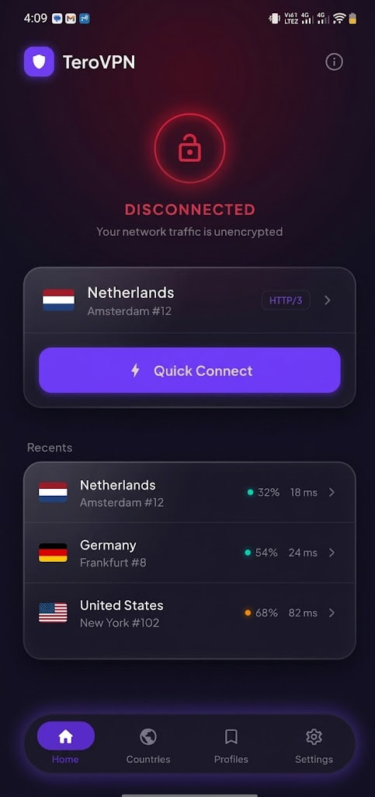
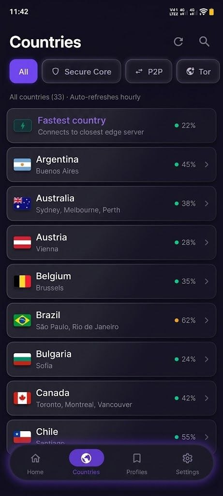
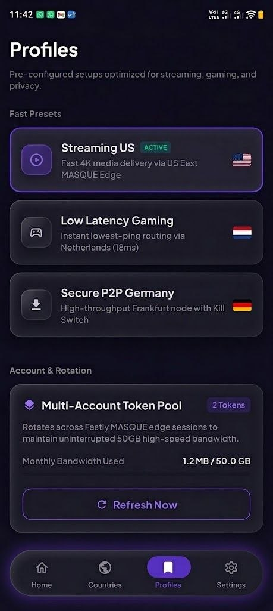
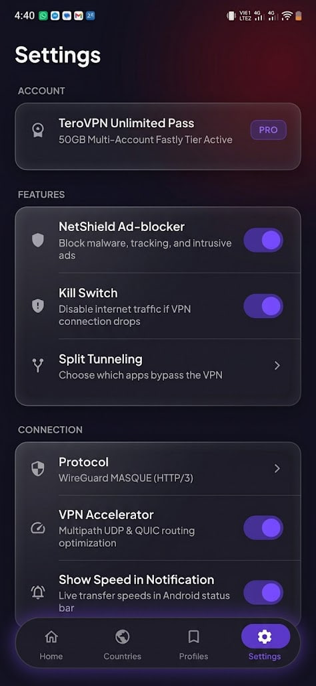
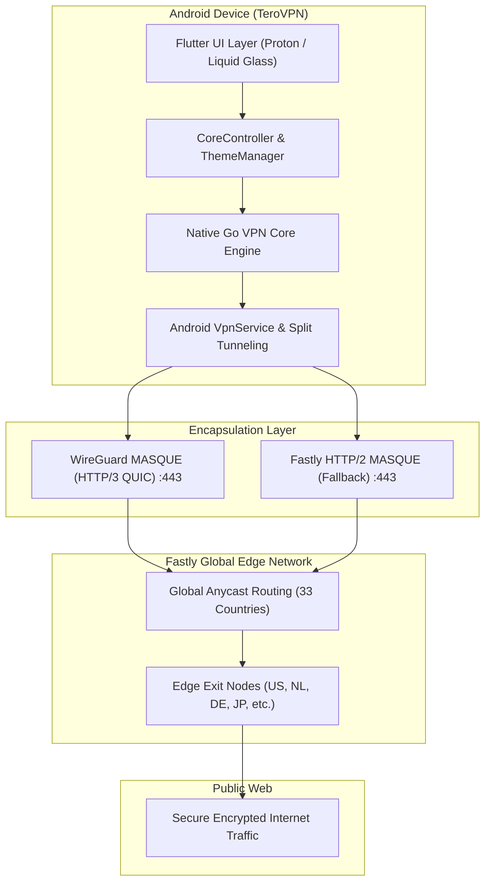

# TeroVPN 🛡️

<p align="center">
  
</p>

<p align="center">
  <strong>Fast, Secure & Private VPN Client for Android</strong><br>
  Powered by <em>WireGuard MASQUE (HTTP/3 QUIC)</em> tunneling over Fastly's global edge network, featuring Proton UI and next-generation Liquid Glass design materials.
</p>

<p align="center">
  <a href="https://github.com/smartworldarafath/TeroVPN/releases/latest"></a>
  
  
  
  
</p>

---

## 🌟 Overview

**TeroVPN** combines carrier-grade censorship circumvention with an ultra-responsive, privacy-respecting user interface. By routing encrypted UDP traffic through **Fastly MASQUE HTTP/3 (QUIC)** and **HTTP/2** edge proxies, TeroVPN bypasses strict state firewalls and deep packet inspection (DPI) while preserving native line-speed bandwidth and low latencies.

Whether you're streaming 4K media, gaming with ultra-low latency, or securing public Wi-Fi sessions, TeroVPN provides hardened cryptographic protection and seamless multi-account quota rotation.

---

## 📸 Screenshots Showcase

<table align="center">
  <tr>
    <td align="center" width="25%">
      <strong>🏠 Home Screen</strong><br>
      <em>Circular Halo & Quick Connect</em><br><br>
      
    </td>
    <td align="center" width="25%">
      <strong>🌍 Countries & Latency</strong><br>
      <em>33 Global Edge Locations</em><br><br>
      
    </td>
    <td align="center" width="25%">
      <strong>⚡ Fast Presets</strong><br>
      <em>Profiles & 50GB Token Pool</em><br><br>
      
    </td>
    <td align="center" width="25%">
      <strong>⚙️ Settings & Core</strong><br>
      <em>Grouped Glass Controls</em><br><br>
      
    </td>
  </tr>
</table>

---

## 🚀 Key Features

### 🔒 WireGuard MASQUE (HTTP/3 QUIC) Tunneling
- Encapsulates WireGuard UDP packets inside standard QUIC HTTP/3 web traffic over port 443.
- Completely impervious to ISP traffic shaping, SNI inspection, and protocol filtering.
- Fast fallback to Fastly HTTP/2 MASQUE encapsulation on networks where UDP/QUIC is blocked.

### 🌐 33 Global Anycast Edge Locations
- Instant routing across 33 global edge nodes spanning North America, Europe, Asia-Pacific, and South America.
- **Fastest Country Anycast**: Automatically tests and locks onto the closest server with the lowest ping.
- Live real-time ping latency (ms) and server load (%) reporting with 1-hour periodic and manual refresh.

### 🎨 Proton UI & Liquid Glass Design System
- **Classic Proton UI**: Official Proton VPN obsidian dark mode with subtle border contrast.
- **Liquid Glass Mode**: Translucent frosted glass materials (`sigma: 20`), underneath neon violet glow (`#6B42FF`), and floating capsule navigation dock.
- Full dynamic reactivity across all screens with edge-to-edge Android layout support.

### 🔄 Multi-Account Session Rotation Pool
- Real-time 50GB high-speed session management with Firefox Account integration.
- Hot-swappable secondary accounts remain paused until activated, eliminating manual token management.
- Live bandwidth consumption meter (`X.X MB of 50.0 GB`) with instant quota refresh.

### 🛡️ Defensive Privacy & Security
- **NetShield Ad-Blocker**: Upstream DNS filtering blocks advertisements, malware, and intrusive trackers.
- **Kill Switch Protection**: Instantly cuts internet traffic if the VPN tunnel drops to prevent unencrypted leaks.
- **Split Tunneling**: Granular per-app routing with installed Android application icons and package filtering.
- **Strict Zero-Logs**: No traffic logs, DNS query logging, or session IP tracking.

### 📲 In-App GitHub OTA Auto-Updater
- Checks releases directly against GitHub REST API with release notes formatting.
- Live download speed meter in **Mbps**, background download progress bar, and direct package installer.

---

## 🏗️ Architecture & Protocol Stack



---

## 📊 Protocol Comparison

| Feature | WireGuard MASQUE (HTTP/3) | Fastly HTTP/2 MASQUE | Smart (Automatic) |
| :--- | :---: | :---: | :---: |
| **Transport** | QUIC over UDP | TLS over TCP | Dynamic Selection |
| **DPI / Firewall Bypass** | ⭐⭐⭐⭐⭐ Highest | ⭐⭐⭐⭐ Very High | ⭐⭐⭐⭐⭐ Adaptive |
| **Latency & Ping** | Lowest (<20ms local) | Low (~25-35ms) | Auto-Optimized |
| **Head-of-Line Blocking** | ❌ None (Independent streams) | ⚠️ TCP-bound | ❌ Minimal |
| **Network Roaming** | Instant connection migration | Re-handshake needed | Seamless |
| **Recommended For** | Gaming, 4K Streaming, Everyday | Restricted corporate / hotel Wi-Fi | Default for all users |

---

## 📥 Download & Installation

### Option 1: Direct APK Download
Grab the latest verified APK directly from the [Releases](https://github.com/smartworldarafath/TeroVPN/releases/latest) page:

1. Download `TeroVPN-Android-v1.0.8.apk`.
2. Open the APK file on your Android device (ensure *Install from unknown sources* is enabled).
3. Follow the on-screen prompts to launch TeroVPN.

### Option 2: Install via ADB

```bash
# Connect device via USB or Wi-Fi debugging
adb install -r out/TeroVPN-Android-v1.0.8.apk
```

---

## 🛠️ Building from Source

### Prerequisites
- [Flutter SDK](https://flutter.dev) (v3.13+ / 3.47 recommended)
- [Android Studio & Android SDK](https://developer.android.com/studio) (API level 26 minimum, API 34+ target)
- Java JDK 17 or JDK 21

### Step-by-Step Build

```bash
# 1. Clone repository
git clone https://github.com/smartworldarafath/TeroVPN.git
cd TeroVPN

# 2. Navigate to Flutter app directory
cd app

# 3. Fetch project dependencies
flutter pub get

# 4. Run lint and static analyzer
flutter analyze

# 5. Run test suite
flutter test

# 6. Build debug APK
flutter build apk --debug

# 7. Output location:
# app/build/app/outputs/flutter-apk/app-debug.apk
```

---

## 📁 Repository Structure

```
TeroVPN/
├── app/
│   ├── android/              # Native Android wrapper & VpnService bindings
│   ├── assets/               # Flags and vector assets
│   ├── lib/
│   │   ├── core/             # Core controller, Fastly API, preferences & models
│   │   ├── theme/            # ProtonTheme, ProtonColors, ThemeManager
│   │   └── ui/
│   │       ├── components/   # Reusable UI widgets, flag icons, load bars
│   │       ├── countries/    # Country selection screen & search engine
│   │       ├── home/         # Home screen, circular lock ring, connection card
│   │       ├── profiles/     # Fast presets & Multi-Account Token Pool
│   │       ├── settings/     # Account management, split tunneling, OTA updater
│   │       └── shell/        # Navigation shell & floating ProtonDock
│   ├── pubspec.yaml          # Flutter package configuration
│   └── test/                 # Widget and unit tests
├── docs/
│   └── screenshots/          # High-resolution application screenshots
├── out/                      # Packaged release binaries
└── README.md                 # Project documentation
```

---

## 🔒 Security & Zero-Leak Policy

- **No Hardcoded Secrets**: TeroVPN strictly externalizes all session tokens, encryption keys, and credentials.
- **Leak Protection**: DNS queries are encrypted and routed exclusively through secure MASQUE tunnels, preventing IPv4/IPv6 and WebRTC leaks.
- **Client Integrity**: Code audits and pre-commit scans ensure zero plaintext credential exposure.

---

## 📄 License

This project is licensed under the **GNU General Public License v3.0 (GPL-3.0)**. See the [LICENSE](LICENSE) file for complete details.

---

<p align="center">
  Crafted with precision for open, unrestricted, and private internet access. 🛡️
</p>
