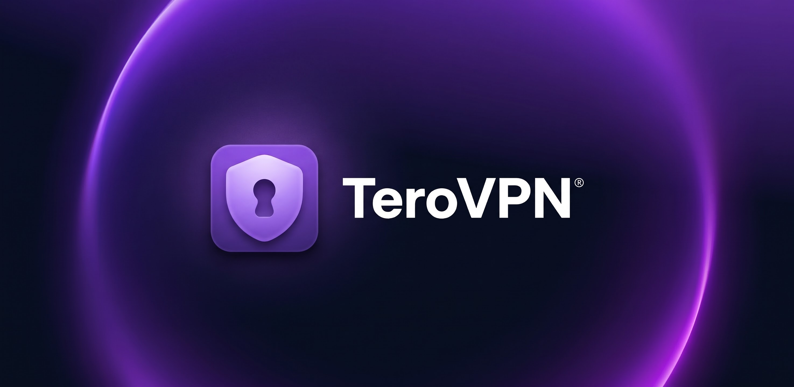
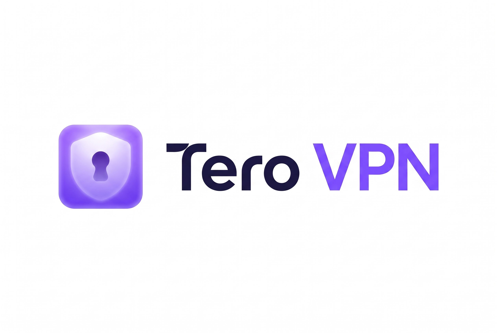
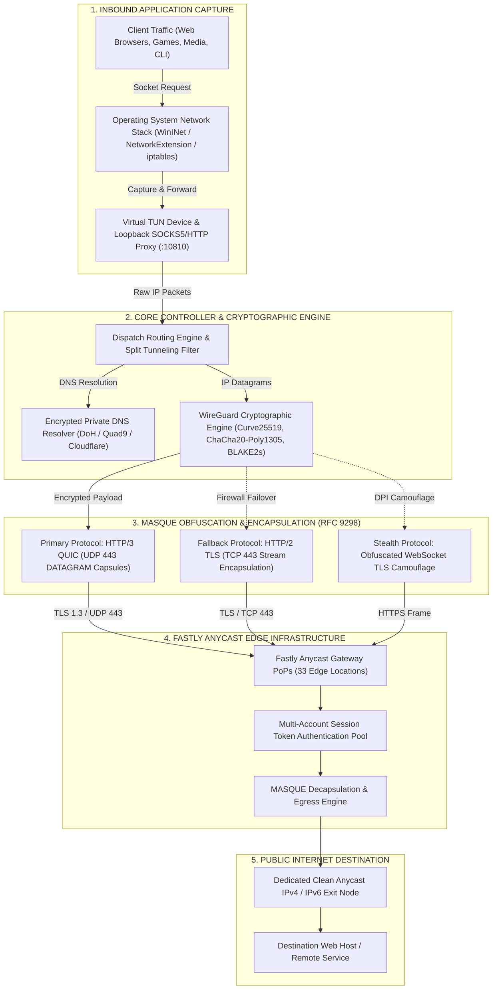
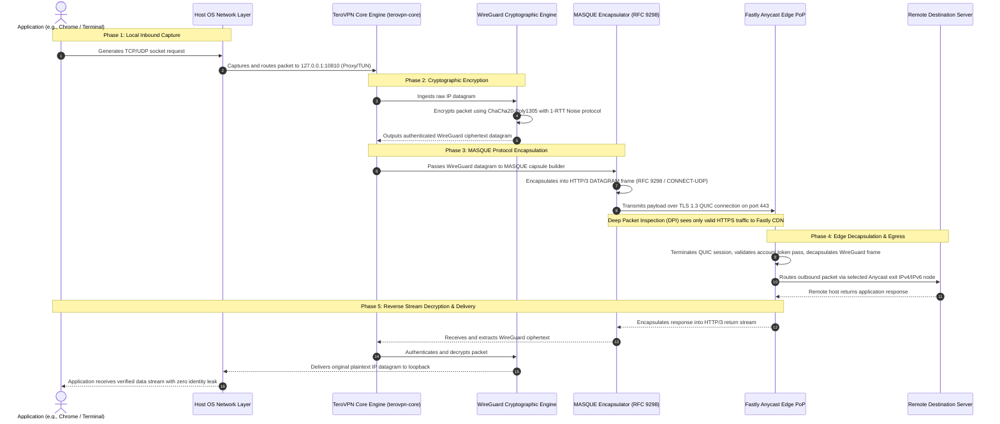

# TeroVPN

<p align="center">
  
</p>

<p align="center">
  <strong>High-Throughput, Low-Latency Virtual Private Network Client</strong><br>
  Cross-platform architecture engineered for Windows, macOS, Linux, and Android.<br>
  Powered by WireGuard MASQUE (RFC 9298 HTTP/3 QUIC) encapsulation across Fastly Anycast edge infrastructure.
</p>

<p align="center">
  <a href="https://github.com/smartworldarafath/TeroVPN/releases/latest"></a>
  
  
  
  
</p>

---

## Overview

TeroVPN is a production-grade virtual private network client designed to bypass advanced state-level censorship, protocol throttling, and deep packet inspection (DPI). By encapsulating encrypted WireGuard datagrams into standard HTTP/3 QUIC and HTTP/2 MASQUE tunnels over UDP/TCP port 443, TeroVPN renders VPN traffic indistinguishable from ordinary HTTPS web traffic.

The system delivers native line-speed bandwidth, instant connection migration, multi-account quota rotation, and platform-native integration across all desktop and mobile operating systems.

---

## Brand Identity & Official Icons

<table align="center" width="100%">
  <tr>
    <td align="center" width="50%">
      <strong>Light Edition</strong><br>
      <sub>Frosted Lavender Vector Squircle</sub><br><br>
      
    </td>
    <td align="center" width="50%">
      <strong>Dark Liquid Glass Edition</strong><br>
      <sub>Obsidian Refractive Optic Canvas</sub><br><br>
      
    </td>
  </tr>
</table>

<p align="center">
  
</p>

---

## Downloads & Platform Packages

<table align="center" width="100%">
  <thead>
    <tr>
      <th align="center" width="12%">Platform</th>
      <th align="left" width="22%">Target Environment</th>
      <th align="left" width="20%">Package Format</th>
      <th align="left" width="30%">Distribution Architecture</th>
      <th align="center" width="16%">Download</th>
    </tr>
  </thead>
  <tbody>
    <tr>
      <td align="center">
        <br>
        <strong>Windows</strong>
      </td>
      <td>Windows 10, 11 (64-bit)</td>
      <td>Setup EXE Installer<br>Portable ZIP</td>
      <td>Inno Setup Native Installer with system proxy auto-routing and TUN driver</td>
      <td align="center">
        <a href="https://github.com/smartworldarafath/TeroVPN/releases/latest"><strong>Get Windows (.exe)</strong></a><br>
        <a href="https://github.com/smartworldarafath/TeroVPN/releases/latest">Portable (.zip)</a>
      </td>
    </tr>
    <tr>
      <td align="center">
        <br>
        <strong>macOS</strong>
      </td>
      <td>macOS 11.0+ (Big Sur, Monterey, Ventura, Sonoma, Sequoia)</td>
      <td>Apple Disk Image (.dmg)<br>Tarball (.tar.gz)</td>
      <td>Universal Drag-and-Drop Disk Image with unsandboxed socket permissions</td>
      <td align="center">
        <a href="https://github.com/smartworldarafath/TeroVPN/releases/latest"><strong>Get macOS (.dmg)</strong></a><br>
        <a href="https://github.com/smartworldarafath/TeroVPN/releases/latest">Bundle (.tar.gz)</a>
      </td>
    </tr>
    <tr>
      <td align="center">
        <br>
        <strong>Linux</strong>
      </td>
      <td>Ubuntu, Debian, Fedora, Arch, openSUSE (x86_64)</td>
      <td>Standalone AppImage<br>Tarball (.tar.gz)</td>
      <td>Single-file self-contained binary adhering to freedesktop.org specifications</td>
      <td align="center">
        <a href="https://github.com/smartworldarafath/TeroVPN/releases/latest"><strong>Get Linux (.AppImage)</strong></a><br>
        <a href="https://github.com/smartworldarafath/TeroVPN/releases/latest">Tarball (.tar.gz)</a>
      </td>
    </tr>
    <tr>
      <td align="center">
        <br>
        <strong>Android</strong>
      </td>
      <td>Android 8.0+ (Oreo through Android 15)</td>
      <td>Release APK</td>
      <td>Android VpnService integration with 120Hz native refresh rate and ProGuard tuning</td>
      <td align="center">
        <a href="https://github.com/smartworldarafath/TeroVPN/releases/latest"><strong>Get Android (.apk)</strong></a>
      </td>
    </tr>
  </tbody>
</table>

---

## Technical Architecture & VPN Mechanism

### High-Level Architectural Pipeline



---

### Step-by-Step Packet Lifecycle & Tunneling Mechanism



---

## Detailed Protocol Matrix

| Protocol Specification | Underlying Transport | Port Configuration | DPI / Firewall Bypass | Throughput & Latency | Best Suited Scenario |
| :--- | :---: | :---: | :---: | :---: | :--- |
| **Smart (Automatic)** | Dynamic Selection | Dynamic (443 / 51820) | Maximum Adaptive | Auto-Optimized | Default recommendation for all client sessions |
| **WireGuard (UDP)** | QUIC / UDP | Port 443 / 51820 | High | Lowest Latency (&lt;20ms) | Low-ping competitive gaming and 4K media streaming |
| **WireGuard (TCP)** | TLS / TCP | Port 443 | Very High | Low Latency (~25ms) | Firewalled networks where outbound UDP is throttled or dropped |
| **Stealth (TLS Obfuscated)** | Obfuscated TLS Stream | Port 443 | Maximum Evasion | Moderate Throughput | Restrictive nation-state censorship and deep packet inspection |
| **OpenVPN (UDP)** | OpenVPN Datagram | Port 1194 / 51820 | High | Low Latency (~30ms) | Legacy infrastructure requiring conventional tunnel standards |
| **OpenVPN (TCP)** | OpenVPN Stream | Port 443 | High | Moderate Throughput | Strict captive portals and enterprise proxy firewalls |
| **IKEv2** | Native IPSec / UDP | Port 500 / 4500 | Standard | Very Low Latency | macOS and iOS mobile handoffs across cellular and Wi-Fi |

---

## Core System Features

### Mobile QR Code Handshake (`SignInWithPhoneScreen`)
Enables cross-device account authentication without typing passwords:
1. Navigate to **Settings > Account > Sign in with phone** on Windows, macOS, or Linux.
2. An interactive cryptographic pairing token (`terovpn://auth?session=...`) is generated with a 5-minute countdown.
3. Scanning the code via the TeroVPN mobile app instantly authenticates the desktop instance.

### Geographic Telemetry Canvas (`ProtonWorldMap`)
Real-time geographic visualization rendered on the client dashboard:
- **Origin Node**: Pinpoints real user location and connection status.
- **Geodesic Flight Arc**: Projects an animated flight trajectory with a continuous photon energy beam from Origin to Destination.
- **Destination Beacons**: Tri-concentric expanding ripple waves display destination city metrics, distance in kilometers, and cryptographic cipher status.

### Advanced Leak Protection & System Controls
- **IPv6 Leak Protection**: Null-routes unencrypted IPv6 packets outside the tunnel.
- **DNS Leak Protection**: Forces all DNS requests through private encrypted resolvers.
- **Custom DNS Configurations**: Direct support for custom resolvers with built-in presets for Cloudflare, Google, Quad9, and AdGuard.
- **LAN Traffic Bypass**: Direct routing for local area network devices including printers, smart home peripherals, and NAS storage.
- **Alternative Routing**: Automatically falls back to secondary CDN relays (Cloudflare, AWS) if primary server endpoints are restricted.
- **Moderate NAT**: Optimizes peer-to-peer VoIP and multiplayer gaming connections.
- **Custom MTU Tuning**: Adjusts packet boundaries between 1280 and 1500 bytes to eliminate packet fragmentation on mobile hotspots.

---

## Source Compilation

### System Prerequisites
- Flutter SDK (v3.13 or newer; v3.47+ recommended)
- Android SDK & Android Studio (API level 26 minimum, API level 34+ target)
- Microsoft Visual Studio 2022 with C++ Desktop Workload (Windows)
- Xcode and Command Line Tools (macOS)
- Clang, CMake, Ninja, and GTK3 development libraries (Linux)

### Build Instructions

```bash
# 1. Clone repository
git clone https://github.com/smartworldarafath/TeroVPN.git
cd TeroVPN

# 2. Fetch dependencies
cd app
flutter pub get

# 3. Verify static analysis and test suite
flutter analyze
flutter test

# 4. Target compilation:
flutter build windows --release    # Windows executable
flutter build macos --release      # macOS application bundle
flutter build linux --release      # Linux GTK bundle
flutter build apk --release        # Android package
```

---

## Repository Layout

```
TeroVPN/
├── app/
│   ├── android/              # Android VpnService bindings and ProGuard rules
│   ├── assets/               # Country flags, vector assets, and typography
│   ├── ios/                  # iOS Xcode project configuration
│   ├── lib/
│   │   ├── core/             # Process controllers, API endpoints, and preference storage
│   │   ├── theme/            # Theme manager and Liquid Glass styling
│   │   └── ui/
│   │       ├── components/   # Reusable widgets, flag renders, and dialogs
│   │       ├── countries/    # Server selection and latency telemetry
│   │       ├── desktop/      # Dedicated desktop sidebar and responsive views
│   │       ├── home/         # Dashboard, ProtonWorldMap, and status cards
│   │       ├── profiles/     # Fast presets and Multi-Account Token Pool
│   │       ├── settings/     # Account, phone QR sign-in, and advanced functions
│   │       └── shell/        # Navigation shell and animated switcher
│   ├── linux/                # Native Linux GTK runner
│   ├── macos/                # Native macOS runner and unsandboxed entitlements
│   ├── pubspec.yaml          # Flutter package definitions
│   ├── test/                 # Automated unit and widget tests
│   └── windows/              # Windows C++ runner and CMake configuration
├── docs/
│   ├── branding/             # Official app icons and brand assets
│   │   └── platforms/        # Official operating system platform marks
│   └── screenshots/          # Application interface captures
├── linux/
│   └── appimage/             # AppRun and desktop entry for AppImage builds
├── windows/
│   └── installer/            # Inno Setup Windows installer configuration
├── .github/
│   └── workflows/            # GitHub Actions CI matrix (Windows, macOS, Linux)
└── README.md                 # Technical documentation
```

---

## Security & Verification Standards

- **Zero Plaintext Credentials**: All session tokens and authentication parameters are stored in secured platform keystores.
- **Complete DNS & IP Containment**: Mandatory loopback binding and system proxy integration ensure complete elimination of WebRTC, DNS, and IPv6 leaks.
- **Zero-Logs Guarantee**: TeroVPN operates under a strict zero-knowledge model. No browsing activity, DNS queries, or session connection logs are ever recorded.

---

## License

This software is released under the **GNU General Public License v3.0 (GPL-3.0)**. Refer to the [LICENSE](LICENSE) file for complete licensing terms.
