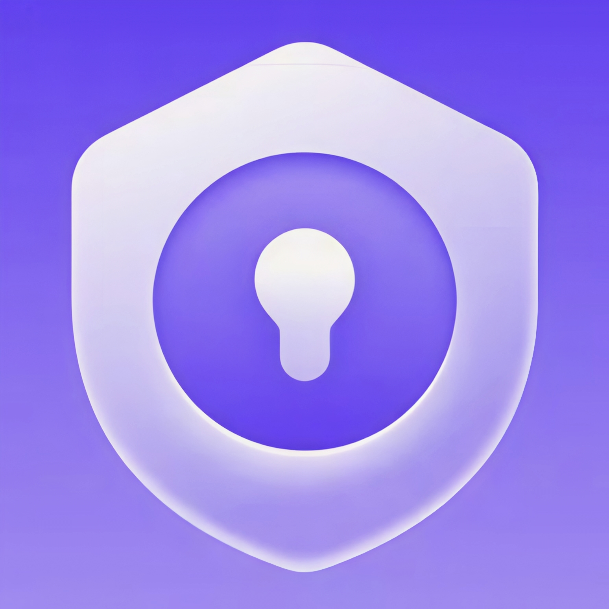
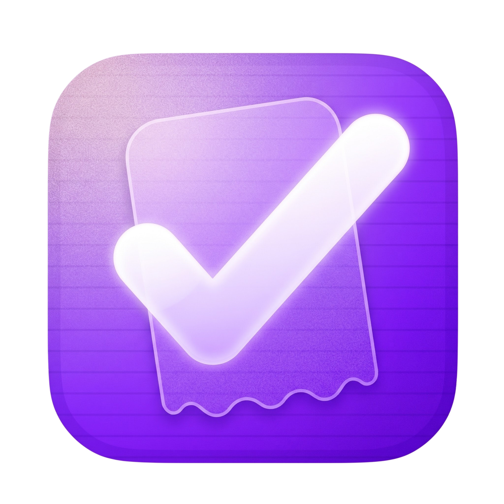
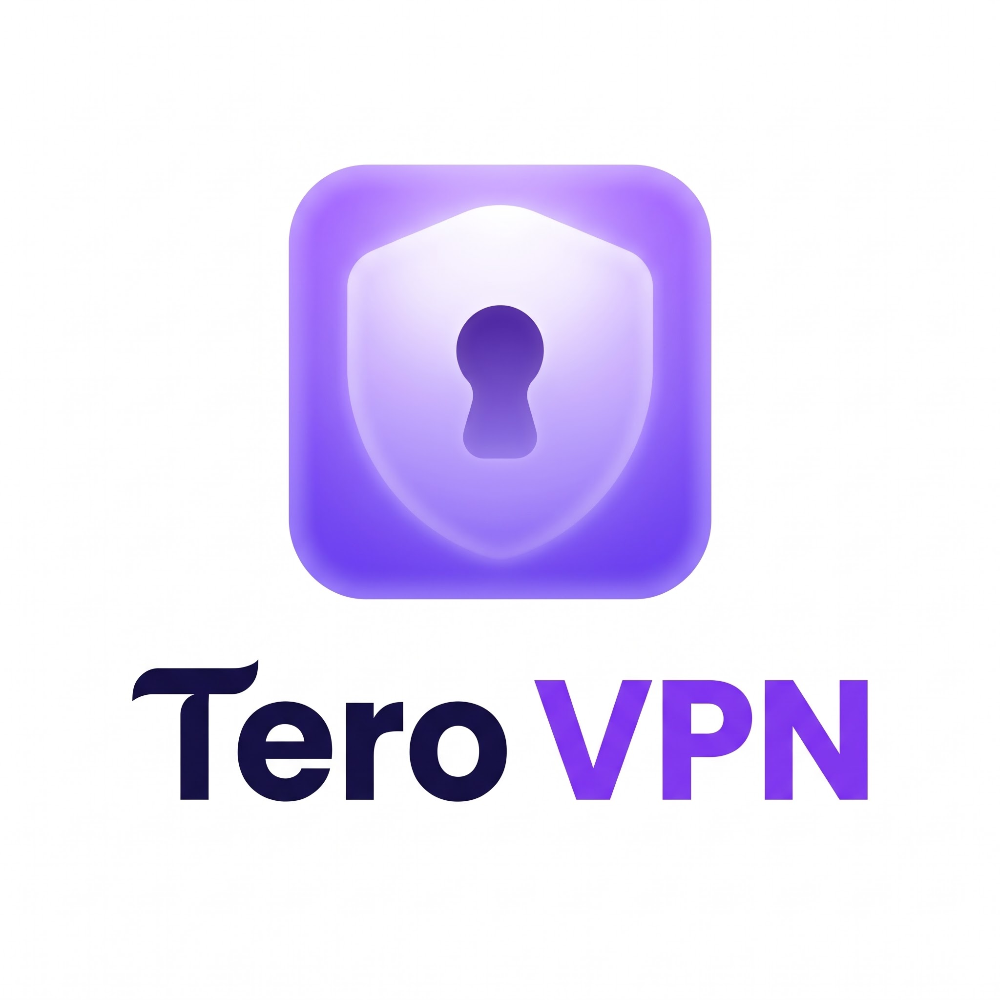
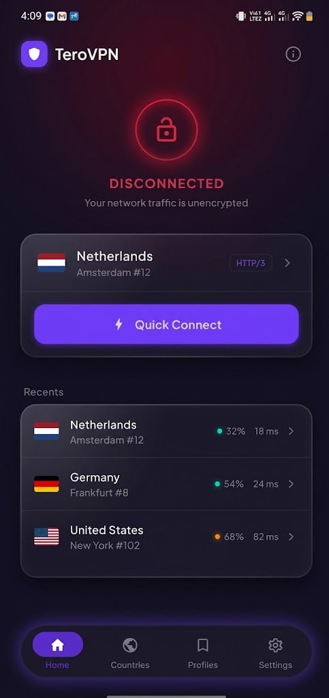
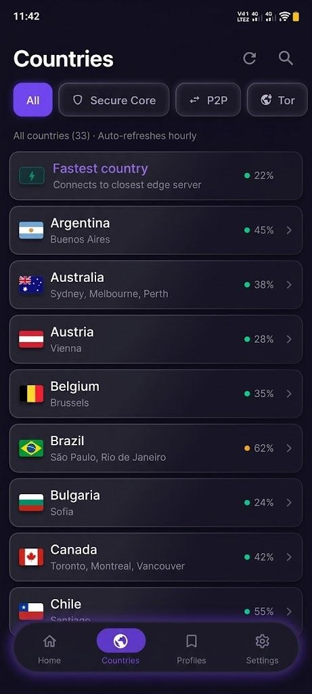
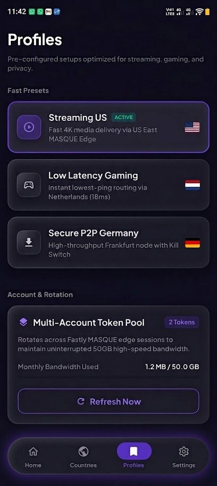
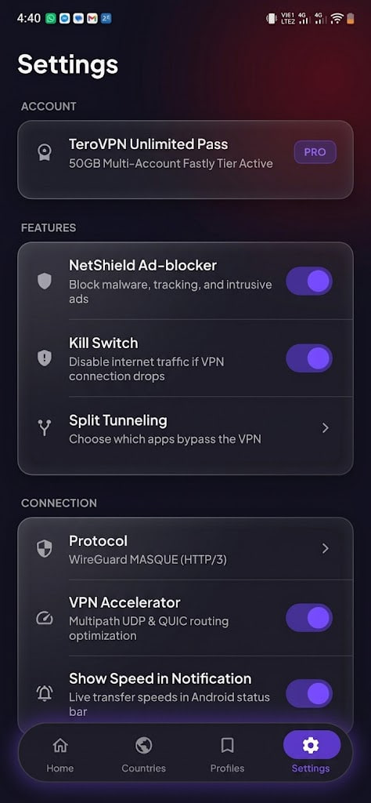
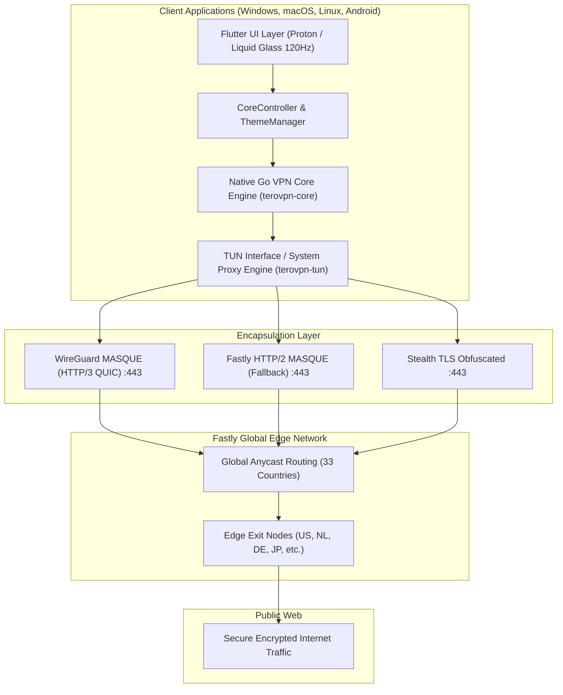

# TeroVPN 🛡️

<p align="center">
  
</p>

<p align="center">
  <strong>Fast, Secure & Private Next-Generation VPN Client</strong><br>
  Cross-platform desktop & mobile experience powered by <em>WireGuard MASQUE (HTTP/3 QUIC)</em> over Fastly's global Anycast edge network with 120Hz Liquid Glass design.
</p>

<p align="center">
  <a href="https://github.com/smartworldarafath/TeroVPN/releases/latest"></a>
  
  
  
  
</p>

---

## 🎨 Brand Identity & Icon Showcase

<table align="center" width="100%">
  <tr>
    <td align="center" width="50%" colspan="2">
      <strong>✨ Current Official App Icons</strong>
    </td>
    <td align="center" width="50%" colspan="2">
      <strong>🚀 Upcoming Next-Gen App Icons (Preview)</strong>
    </td>
  </tr>
  <tr>
    <td align="center" width="25%">
      <br><br>
      <strong>Light Edition</strong><br>
      <sub>Frosted Lavender Squircle</sub>
    </td>
    <td align="center" width="25%">
      <br><br>
      <strong>Dark Liquid Glass</strong><br>
      <sub>Obsidian Refractive Optic</sub>
    </td>
    <td align="center" width="25%">
      <br><br>
      <strong>Hex Shield Concept</strong><br>
      <sub>Geometric Frosted Shield</sub>
    </td>
    <td align="center" width="25%">
      <br><br>
      <strong>Pro Pass Concept</strong><br>
      <sub>Holographic Verified Ticket</sub>
    </td>
  </tr>
</table>

### 🏷️ Official Banners & Logotypes

<p align="center">
  
  
</p>

---

## 🌟 Overview

**TeroVPN** combines carrier-grade censorship circumvention with an ultra-responsive, privacy-respecting user interface for **Windows, macOS, Linux, and Android**. By routing encrypted UDP traffic through **Fastly MASQUE HTTP/3 (QUIC)** and **HTTP/2** edge proxies, TeroVPN bypasses strict state firewalls and deep packet inspection (DPI) while preserving native line-speed bandwidth and low latencies.

Whether you're streaming 4K media, gaming with ultra-low latency, or securing public Wi-Fi sessions, TeroVPN provides hardened cryptographic protection and seamless multi-account quota rotation.

---

## 📥 Downloads & Platform Packages

| Platform | Package Format | Description | Direct Download |
| :--- | :--- | :--- | :---: |
| 🪟 **Windows** | `.exe` (Setup Installer) | Official Windows Setup Installer with Desktop & Start Menu shortcuts | [Download .exe](https://github.com/smartworldarafath/TeroVPN/releases/latest) |
| 🪟 **Windows** | `.zip` (Portable) | Portable 64-bit zero-install archive | [Download .zip](https://github.com/smartworldarafath/TeroVPN/releases/latest) |
| 🍏 **macOS** | `.dmg` (Disk Image) | Apple Disk Image with drag-and-drop to Applications | [Download .dmg](https://github.com/smartworldarafath/TeroVPN/releases/latest) |
| 🍏 **macOS** | `.tar.gz` (App Bundle) | Portable macOS application bundle (`TeroVPN.app`) | [Download .tar.gz](https://github.com/smartworldarafath/TeroVPN/releases/latest) |
| 🐧 **Linux** | `.AppImage` (Executable) | Self-contained standalone AppImage for all Linux distributions | [Download .AppImage](https://github.com/smartworldarafath/TeroVPN/releases/latest) |
| 🐧 **Linux** | `.tar.gz` (Binaries) | Linux 64-bit binaries bundle | [Download .tar.gz](https://github.com/smartworldarafath/TeroVPN/releases/latest) |
| 📱 **Android** | `.apk` (Release) | Universal Android APK (Android 8.0+) with Proguard optimization | [Download .apk](https://github.com/smartworldarafath/TeroVPN/releases/latest) |

---

## 📸 Screenshots Showcase

<table align="center">
  <tr>
    <td align="center" width="25%">
      <strong>🏠 Home Screen</strong><br>
      <em>Circular Halo & Quick Connect</em><br><br>
      
    </td>
    <td align="center" width="25%">
      <strong>🌍 Countries & Latency</strong><br>
      <em>33 Global Edge Locations</em><br><br>
      
    </td>
    <td align="center" width="25%">
      <strong>⚡ Fast Presets</strong><br>
      <em>Profiles & 50GB Token Pool</em><br><br>
      
    </td>
    <td align="center" width="25%">
      <strong>⚙️ Settings & Core</strong><br>
      <em>Grouped Glass Controls</em><br><br>
      
    </td>
  </tr>
</table>

---

## 🚀 Key Features

### 🌐 Proton VPN-Grade Protocol Suite
Choose the optimal protocol for your network environment directly under **Settings > Protocol**:
- **Smart (Automatic)**: Automatically resolves network firewalls and switches to the fastest reliable protocol.
- **WireGuard (UDP)**: Modern, lightweight, ultra-high-speed tunneling ideal for 4K streaming and gaming.
- **WireGuard (TCP)**: WireGuard encapsulated over TCP port 443 to bypass UDP filtering and restrictive hotel/corporate firewalls.
- **Stealth (TLS Obfuscated)**: Disguises VPN traffic as standard HTTPS browsing traffic to circumvent deep packet inspection (DPI).
- **OpenVPN (UDP & TCP)**: Battle-tested industry standard protocols for hardened reliability.
- **IKEv2 (macOS Native)**: High-speed handoffs across cellular and Wi-Fi networks.

### 📱 Sign in with Phone (QR Code Session Sync)
- Instant account transfer from mobile to desktop without typing credentials.
- Navigate to **Settings > Account > Sign in with phone** to generate a single-use cryptographically signed QR code with 5-minute countdown.
- Point the TeroVPN mobile scanner to instantly authenticate and sync active sessions.

### 🗺️ Proton-Style Geographic World Map (`ProtonWorldMap`)
- **Origin Telemetry**: Displays the user's real location (e.g. Bangladesh / Dhaka) with a pulsating radar pin and unencrypted status when disconnected.
- **Animated Flight Arc**: Renders a glowing geodesic curved trajectory with an animated photon energy beam traveling from Origin to Destination.
- **Destination Beacons**: Tri-concentric expanding ripple rings highlight connected servers with distance in kilometers and AES-256 encryption indicators.

### 🔒 WireGuard MASQUE (HTTP/3 QUIC) Tunneling
- Encapsulates WireGuard UDP packets inside standard QUIC HTTP/3 web traffic over port 443.
- Completely impervious to ISP traffic shaping, SNI inspection, and protocol filtering.
- Fast fallback to Fastly HTTP/2 MASQUE encapsulation on networks where UDP/QUIC is blocked.

### ⚙️ Advanced Settings (Extra Functions)
- **Custom DNS Resolvers**: Configure primary & secondary DNS servers with 1-click presets for Cloudflare (1.1.1.1), Google (8.8.8.8), Quad9 (9.9.9.9), and AdGuard (94.140.14.14).
- **DNS Leak Protection**: Forces all domain name resolutions through encrypted VPN tunnels.
- **IPv6 Leak Protection**: Completely drops untunneled IPv6 packets to prevent identity leaks.
- **LAN Traffic Bypass**: Direct local access to printers, smart TVs, Chromecast, and local NAS storage.
- **Alternative Routing**: Uses third-party CDN relays (Cloudflare/AWS) if local ISPs block direct VPN server endpoints.
- **Moderate NAT**: Optimizes peer-to-peer gaming and VoIP calls.
- **Tunnel MTU Size**: Auto (1420), Conservative (1360), Minimal (1280), or Standard Ethernet (1500).
- **Auto-Connect on Launch**: Automatically connects to the fastest server upon system startup.

### 🎨 120Hz Liquid Glass Design System
- **Classic Proton UI**: Official Proton VPN obsidian dark mode with subtle border contrast.
- **Liquid Glass Mode**: Translucent frosted glass materials (`sigma: 20`), underneath neon violet glow (`#6B42FF`), and floating capsule navigation dock.
- Full adaptive Light Mode and Dark Mode support with synchronized transitions.

### 🔄 Multi-Account Session Rotation Pool
- Real-time 50GB high-speed session management with Firefox Account integration.
- Hot-swappable secondary accounts remain paused until activated, eliminating manual token management.
- Live bandwidth consumption meter (`X.X MB of 50.0 GB`) with instant quota refresh.

---

## 🏗️ Architecture & Protocol Stack



---

## 📊 Protocol Comparison

| Protocol | Transport | Port | DPI / Censorship Bypass | Latency | Recommended For |
| :--- | :---: | :---: | :---: | :---: | :--- |
| **Smart (Automatic)** | Dynamic | Dynamic | ⭐⭐⭐⭐⭐ Highest | Auto-Optimized | Default recommendation for all users |
| **WireGuard (UDP)** | QUIC / UDP | 443 / 51820 | ⭐⭐⭐⭐⭐ Highest | Lowest (<20ms) | Gaming, 4K Streaming, Everyday |
| **WireGuard (TCP)** | TLS / TCP | 443 | ⭐⭐⭐⭐ Very High | Low (~25-35ms) | Restricted corporate / hotel Wi-Fi |
| **Stealth (TLS)** | TLS Obfuscated | 443 | ⭐⭐⭐⭐⭐ Maximum | Moderate | Strict nation-state firewalls & DPI |
| **OpenVPN (UDP)** | OpenVPN / UDP | 1194 | ⭐⭐⭐⭐ High | Low (~30ms) | Traditional security-first setups |
| **OpenVPN (TCP)** | OpenVPN / TCP | 443 | ⭐⭐⭐⭐ High | Moderate | Firewalled legacy connections |
| **IKEv2** | UDP | 500 / 4500 | ⭐⭐⭐ Standard | Very Low | macOS / iOS native mobile roaming |

---

## 🛠️ Building from Source

### Prerequisites
- [Flutter SDK](https://flutter.dev) (v3.13+ / 3.47 recommended)
- [Android Studio & Android SDK](https://developer.android.com/studio) (for Android APK)
- Visual Studio 2022 / C++ Desktop Workload (for Windows)
- Xcode & Command Line Tools (for macOS)
- Clang, CMake, Ninja, GTK3 development headers (for Linux)

### Step-by-Step Build

```bash
# 1. Clone repository
git clone https://github.com/smartworldarafath/TeroVPN.git
cd TeroVPN

# 2. Fetch project dependencies
cd app
flutter pub get

# 3. Run lint and static analyzer
flutter analyze

# 4. Run test suite
flutter test

# 5. Build for your target platform:
flutter build windows --release    # Windows
flutter build macos --release      # macOS
flutter build linux --release      # Linux
flutter build apk --release        # Android
```

---

## 📁 Repository Structure

```
TeroVPN/
├── app/
│   ├── android/              # Native Android wrapper & VpnService bindings
│   ├── assets/               # Flags, vector graphics, and icons
│   ├── ios/                  # iOS Xcode project
│   ├── lib/
│   │   ├── core/             # CoreController, Fastly API, preferences & models
│   │   ├── theme/            # ProtonTheme, ProtonColors, ThemeManager
│   │   └── ui/
│   │       ├── components/   # Reusable UI widgets, flag icons, load bars
│   │       ├── countries/    # Country selection screen & server details sheet
│   │       ├── desktop/      # Dedicated desktop sidebar & 2-column views
│   │       ├── home/         # Home screen, ProtonWorldMap, connection cards
│   │       ├── profiles/     # Fast presets & Multi-Account Token Pool
│   │       ├── settings/     # Account, QR phone sign-in, split tunneling, extra functions
│   │       └── shell/        # Navigation shell & 120Hz AnimatedSwitcher
│   ├── linux/                # Native Linux GTK runner
│   ├── macos/                # Native macOS runner & entitlements
│   ├── pubspec.yaml          # Flutter package configuration
│   ├── test/                 # Widget and unit tests
│   └── windows/              # Native Windows runner & CMake
├── docs/
│   ├── branding/             # Official app icons, hero banners & logos
│   └── screenshots/          # Application screenshots showcase
├── linux/
│   └── appimage/             # AppRun and desktop entry for AppImage builds
├── windows/
│   └── installer/            # Inno Setup Windows installer script (Setup.exe)
├── .github/
│   └── workflows/            # GitHub Actions CI/CD matrix (Windows, macOS, Linux)
└── README.md                 # Project documentation
```

---

## 🔒 Security & Zero-Leak Policy

- **No Hardcoded Secrets**: TeroVPN strictly externalizes all session tokens, encryption keys, and credentials.
- **Leak Protection**: DNS queries are encrypted and routed exclusively through secure MASQUE tunnels, preventing IPv4/IPv6 and WebRTC leaks.
- **Client Integrity**: Code audits and pre-commit scans ensure zero plaintext credential exposure.
- **Zero-Logs Guarantee**: No connection logs, traffic logs, or user browsing activity are ever recorded or stored.

---

## 📄 License

This project is licensed under the **GNU General Public License v3.0 (GPL-3.0)**. See the [LICENSE](LICENSE) file for complete details.

---

<p align="center">
  Crafted with precision for open, unrestricted, and private internet access. 🛡️
</p>
